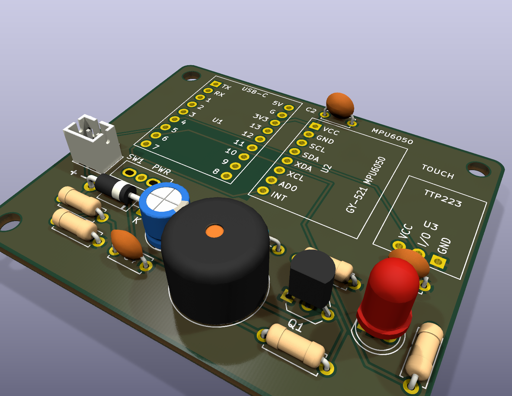

# Mạch phát hiện té ngã – ESP32-S3 SuperMini + MPU6050

Project KiCad 10: sơ đồ nguyên lý, PCB 2 lớp 60 × 50 mm, file Gerber sẵn để đặt mạch.



## Cấu trúc thư mục

| Đường dẫn | Nội dung |
|---|---|
| `fall_detector.kicad_pro/.kicad_sch/.kicad_pcb` | Project KiCad (mở bằng KiCad 10) |
| `lib/` | Symbol + footprint tự tạo (SuperMini, GY-521, TTP223, công tắc SS12D00) |
| `docs/fall_detector_schematic.pdf` | Sơ đồ nguyên lý dạng PDF |
| `docs/pcb_top_3d.png`, `docs/pcb_iso_3d.png` | Ảnh render 3D |
| `production/fall_detector_gerber.zip` | **Gerber + file khoan – upload thẳng lên JLCPCB/PCBWay** |
| `production/bom.csv` | Danh sách linh kiện |
| `scripts/` | Script dựng lại PCB (đặt linh kiện + đi dây cố định; tùy chọn autoroute Freerouting) |

## Nguyên lý

- **Nguồn**: pin Li-Po 3.7 V → module sạc **TP4056 (loại có mạch bảo vệ)** → `J1` → công tắc `SW1` → diode Schottky `D2` 1N5817 → chân **5V** của SuperMini.
  Theo sơ đồ của Nologo, chân 5V nối thẳng VBUS của cổng USB-C và đầu vào LDO ME6217C33 (800 mA) → 3V3.
  `D2` ngăn dòng 5V từ cổng USB-C của SuperMini chảy ngược vào pin khi đang nạp code, và chặn luôn trường hợp cắm ngược cực pin.
- **Đo pin**: cầu phân áp `R4`/`R5` 100k + `C4` 100nF → GPIO1. `Vpin = Vadc × 2`.
- **MPU6050 (GY-521)**: I2C, `AD0` nối GND → địa chỉ `0x68`. GY-521 có sẵn điện trở kéo lên nên không cần thêm. Chân `INT` dùng để đánh thức ESP32 khỏi deep sleep khi có chuyển động.
- **Còi**: `Q1` S8050 đóng cắt phía GND, `R1` 1k hạn dòng base, `R2` 10k giữ còi tắt lúc ESP32 khởi động, `D1` 1N4148 dập xung ngược. Còi 3 V cấp từ 3V3.
- **LED**: `R3` 330 Ω → khoảng 4 mA với LED đỏ.
- **Nút chạm TTP223**: ngõ ra mức cao khi chạm → GPIO4 (dùng để hủy báo động / gọi SOS).
- Tụ `C1` 100 µF giữ ổn định 3V3 khi còi kêu; `C2`, `C3` 100 nF lọc nguồn sát từng module.

## Sơ đồ chân cho firmware

| Chức năng | GPIO | Ghi chú |
|---|---|---|
| I2C SDA (MPU6050) | 8 | `Wire.begin(8, 9)` |
| I2C SCL (MPU6050) | 9 | |
| MPU6050 INT | 7 | Chân RTC → dùng được cho wake-up từ deep sleep |
| TTP223 OUT | 4 | HIGH khi chạm |
| Còi | 5 | HIGH = kêu (còi thụ động thì dùng `ledcWriteTone`) |
| LED | 6 | HIGH = sáng |
| Đo điện áp pin | 1 | ADC1_CH0, nhân 2 |

Đã tránh các chân strapping (GPIO0, 3, 45, 46). LED RGB trên SuperMini vẫn dùng được ở GPIO48.

## Danh sách linh kiện (đều dễ mua ở VN: Hshop, ICDayRoi, Shopee, chợ Nhật Tảo, chợ Trời…)

| Ký hiệu | Linh kiện | SL | Ghi chú khi mua |
|---|---|---|---|
| U1 | ESP32-S3 SuperMini | 1 | Kèm 2 hàng rào **cái** 1×9 2.54 mm để cắm/tháo |
| U2 | Module GY-521 MPU6050 | 1 | Hàng rào cái 1×8 |
| U3 | Module cảm biến chạm TTP223 | 1 | Hàng rào cái 1×3 |
| BZ1 | Còi chip 3 V (12 × 9.5 mm, chân cách 7.6 mm) | 1 | Loại "còi chủ động 3V" |
| Q1 | Transistor S8050 (TO-92) | 1 | Thay được bằng 2N2222A / PN2222A / 2N3904 (cùng thứ tự E-B-C). **Không** dùng C1815 (thứ tự E-C-B) |
| D1 | Diode 1N4148 | 1 | |
| D2 | Diode Schottky 1N5817 | 1 | 1N5819 cũng dùng được nhưng sụt áp cao hơn (chênh tới ~0.1 V khi dòng lớn) |
| D3 | LED 5 mm đỏ | 1 | |
| R1 | Điện trở 1 kΩ 1/4 W | 1 | |
| R2 | Điện trở 10 kΩ 1/4 W | 1 | |
| R3 | Điện trở 330 Ω 1/4 W | 1 | |
| R4, R5 | Điện trở 100 kΩ 1/4 W | 2 | |
| C1 | Tụ hóa 100 µF 16 V (Ø5–6.3 mm) | 1 | |
| C2–C4 | Tụ gốm 104 (100 nF) | 3 | Chân 5 mm (bẻ chân nếu là loại 2.54 mm) |
| J1 | Đầu JST PH 2.0 mm 2 chân (đứng) | 1 | Nối vào OUT+/OUT− của TP4056 |
| SW1 | Công tắc gạt SS12D00 (3 chân) | 1 | Lỗ oval 1.4 × 1.0 mm nhận cả loại chân 2.0 mm và 2.54 mm |
| – | Module sạc TP4056 Type-C có bảo vệ + pin Li-Po 3.7 V | 1 | Nằm ngoài PCB |
| H1–H4 | Ốc M3 + trụ đồng | 4 | |

## Thông số PCB

- 2 lớp, 60 × 50 mm, bo góc R2, 4 lỗ M3.
- Toàn bộ linh kiện xuyên lỗ (hàn tay dễ), **không có via**.
- Đường tín hiệu 0.3 mm, đường nguồn 0.5 mm, khoảng cách tối thiểu 0.25 mm, phủ đồng GND cả hai mặt.
- Không phủ đồng / không đi dây dưới ăng-ten gốm của SuperMini (đầu xa cổng USB-C); lớp trên không phủ đồng dưới nửa dưới module.
- Chữ in lụa cao 1.0 mm, nét 0.15 mm (mức tối thiểu của JLCPCB/PCBWay).
- DRC (KiCad 10): **0 lỗi, 0 chưa nối, 0 lệch so với sơ đồ**. ERC: 0 lỗi.
- Đặt mạch: upload `production/fall_detector_gerber.zip` lên JLCPCB/PCBWay, để thông số mặc định (FR-4 1.6 mm, HASL).

## ⚠ Kiểm tra trước khi đặt mạch / hàn

1. **Thứ tự chân SuperMini**: footprint (nhìn từ trên, cổng USB-C hướng lên):
   cột trái `TX, RX, 1, 2, 3, 4, 5, 6, 7`; cột phải `5V, GND, 3V3, 13, 12, 11, 10, 9, 8`; hai hàng cách nhau 15.24 mm.
   Đã đối chiếu với ảnh pinout và bản vẽ kích thước 23.5 × 18 mm của Nologo ESP32-S3 SuperMini. Tên chân được in lụa lên PCB – vẫn nên so với board thật.
2. **Chiều cắm GY-521**: hàn hàng rào đực vào GY-521 như bình thường (nhựa ở mặt dưới, linh kiện hướng lên).
   Khi cắm: `VCC` vào lỗ vuông trên cùng, thân module chìa sang **phải** (xa ESP32). Nếu thân module chìa về phía ESP32 là đang cắm ngược.
3. **Thứ tự chân TTP223**: footprint dùng `GND, I/O, VCC` (xem nhãn in lụa). Chân giữa luôn là I/O nhưng hai đầu VCC/GND đảo nhau tùy hãng –
   cắm theo **tên chân**, không theo hình khung; cắm ngược là đảo cực nguồn module.
4. **Cực tính pin**: chân `+` của J1 ở bên trái (có in lụa `+ −`). Kiểm tra dây pin/TP4056 trước khi cắm.
5. Khi cắm USB-C vào SuperMini để nạp code, pin **không** được sạc qua cổng này – hãy sạc qua cổng USB của module TP4056.
   Bản SuperMini có mạch sạc riêng (pad `B+`/`B−` + jumper BOOST ở mặt dưới, IC TP4054) – mạch này **không dùng** pad đó.
   Khi chạy bằng pin, đèn `BAT` xanh trên SuperMini có thể chớp mờ vì IC sạc thấy điện áp ở VBUS mà không có pin: bình thường, không hại gì.

## Thay đổi so với v1.0

- **Sửa footprint GY-521 bị lật gương**: v1.0 đặt `VCC` ở dưới cùng, nên khi cắm module đúng chân thì thân module (16 mm) đè lên ESP32 SuperMini.
  v1.1 đặt `VCC` ở trên cùng, thân module chìa sang phải – khớp module thật (đối chiếu 3 footprint GY-521 độc lập).
- Chân GPIO **giữ nguyên** (firmware không cần sửa); đi dây lại quanh GY-521, `C2` dời lên sát chân VCC của GY-521.
- `C1` (tụ hóa vỏ nhôm) dời xa ăng-ten; bỏ phủ đồng / đường mạch dưới ăng-ten SuperMini.
- `D2` đổi 1N5819 → 1N5817 (sụt áp thấp hơn, cùng footprint DO-41).
- Chữ in lụa 0.8 mm / nét 0.12 mm → 1.0 mm / 0.15 mm (dễ đọc hơn khi gia công).
- Lỗ công tắc SS12D00 nới rộng (lỗ giữa 0.8 → 1.0 mm, rãnh oval 0.8 → 1.0 mm).

## Dựng lại PCB từ sơ đồ (tùy chọn)

Mặc định chỉ cần mở file `.kicad_pcb` bằng KiCad. Nếu muốn dựng lại toàn bộ bằng script (không cần Java):

```sh
KB="$LOCALAPPDATA/Programs/KiCad/10.0/bin"
"$KB/kicad-cli" sch export netlist --format kicadsexpr -o net.net fall_detector.kicad_sch
"$KB/python" scripts/build_pcb.py net.net            # đặt linh kiện, viền board, netclass
"$KB/python" scripts/route_manual.py                 # đi dây cố định + vùng cấm ăng-ten + phủ GND
```

Có thể thay bước cuối bằng autoroute Freerouting (cần Java 25 và `freerouting.jar` v2.4+):
`"$KB/python" scripts/route_pcb.py <java.exe> <freerouting.jar> <thư_mục_tạm>`.
